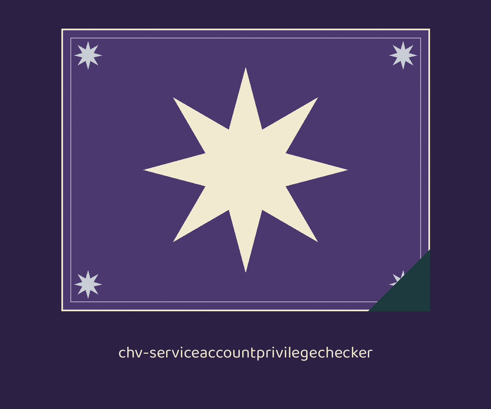

> Hour noted first: first hour. A night watch log entry, Baloo Tamma 2 in moon cream on a dream violet plate, with the star blanket drawn once as a header plate under this block.

# chv-serviceaccountprivilegechecker

# chv-ServiceAccountPrivilegeChecker
Validates a service account configuration file (YAML or JSON) against a JSON schema you supply, and reports every place the config breaks that schema, with the failing path and the schema message. The tool ships with no built in list of allowed or forbidden privileges: privilege limits exist only if the schema you supply encodes them, for example by listing the allowed permission values in an enum. With a schema that only checks that fields are present, a config granting admin, root, and sudo passes as valid. The check is static and file based, with no runtime monitoring.

## Install

> Lantern panel: Wrong Organisation in the Source. The clone line above points to ShadowStrikeHQ, the wrong organisation. It is preserved verbatim and flagged here rather than corrected silently. This repository lives under ShadowGuard-AI.
`git clone https://github.com/ShadowStrikeHQ/chv-serviceaccountprivilegechecker`

## Usage

> Lantern panel: the usage line above is a placeholder and runs nothing. The true command is given in the flagged entry at the end of this document.
`./chv-serviceaccountprivilegechecker [params]`

## Parameters
- `-h`: Show help message and exit
- `-l`: Set the logging level.
- `-o`: No description provided

## License

> Lantern panel: Wrong Name in the Source. The licence line above reads Copyright (c) ShadowStrikeHQ, which is wrong for this repository, while the LICENSE file itself carries the MIT License.
Copyright (c) ShadowStrikeHQ

## Flagged completion from the parser

The entries in this section come from the argument parser in main.py. They are added here in their own flagged entry, never blended into the preserved list above.

- The working invocation is `python3 main.py config.yaml schema.json`, with the configuration first and the schema second, and optional flags after them.
- `config_file` is a required positional giving the path to the configuration file, YAML or JSON.
- `schema_file` is a required positional giving the path to the JSON schema file to validate against.
- `-l`, `--log_level` sets the logging level, with choices DEBUG, INFO, WARNING, ERROR, and CRITICAL, and INFO as the default.
- `-o`, `--output_file` gives the path to the output file for the report, and is optional.
- Validation collects every failure in one pass rather than stopping at the first, and each failure is reported with its message and its path joined by dots.
- A failure at the document root has an empty path, so the report prints a blank after Path for exactly the errors that describe the file as a whole.
- The schema chooses its own dialect through its $schema key, while a schema without one is judged by the newest draft the library knows, and the report never says which dialect did the judging.
- The report is printed, or written to the output file when one is given, and losing that write is treated as a failure of the run. The run exits with code 1 when validation errors exist.
- The configuration format is decided by file extension, .yaml, .yml, or .json, with any other extension rejected as unsupported.
- requirements.txt lists jsonschema at version 4.17.0 or above and PyYAML at version 6.0 or above, though the preserved install passage gives no package install step.
